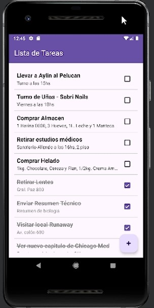
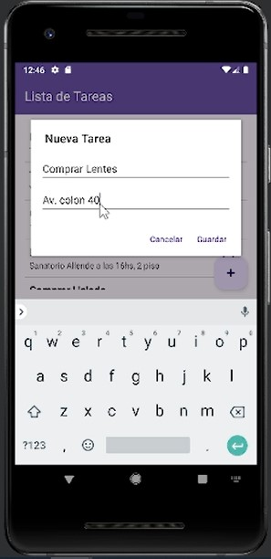
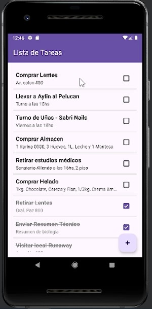
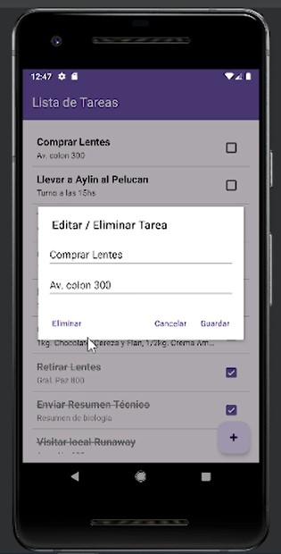
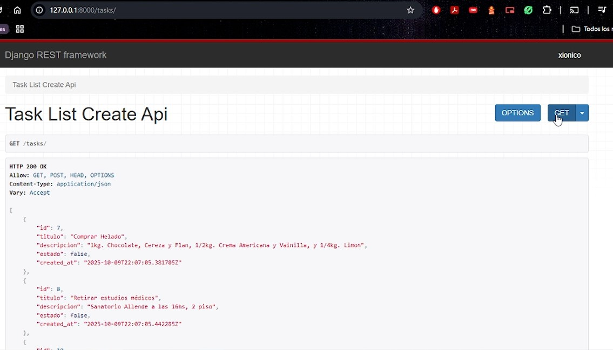
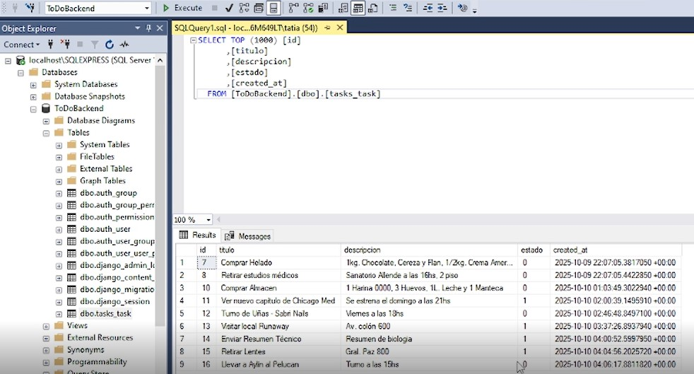

# To-Do List App (Android + Django REST)

Este proyecto demuestra el desarrollo completo de una aplicación **To-Do List** con **persistencia local y remota**, integrando un frontend móvil desarrollado en **Android (Kotlin)** y un backend en **Python (Django REST Framework)** con base de datos **SQL Server**.

---

## Descripción general

La aplicación permite gestionar tareas de forma sencilla, incluso sin conexión a internet.  
Cuando hay conexión, consulta el backend y actualiza la base local con los datos remotos.

Este proyecto fue diseñado para mostrar habilidades de desarrollo **full stack**, manejo de **APIs REST**, y una separación de responsabilidades en la app móvil (Fragment, Repository, Room y Retrofit) y un backend con **Django REST Framework**.

---

## Backend – Django REST Framework

El backend fue desarrollado en **Python 3.12** con **Django REST Framework**, utilizando **SQL Server** como base de datos principal.  
Expone endpoints REST para crear, listar, editar y eliminar tareas, los cuales son consumidos por la aplicación móvil.

### Base de datos
- **Nombre:** `ToDoBackend` (configurable)
- **Motor:** SQL Server

La conexión se configura en `settings.py` a partir de variables de entorno. En `ToDoBackend/backend_django/.env.example` están todas las variables disponibles. El repositorio no incluye credenciales: cada quien usa las propias.

### Configuración de credenciales
1. Crear en SQL Server una base de datos y un usuario con permisos sobre ella.
2. Copiar `.env.example` como `.env` y completar los valores (`DJANGO_SECRET_KEY`, `DB_NAME`, `DB_USER`, `DB_PASSWORD`, `DB_HOST`, etc.). El archivo `.env` está en `.gitignore` y no se sube al repositorio.
3. Django no lee `.env` por sí solo, así que hay que exportar las variables en la terminal antes de levantar el servidor. En PowerShell:

```powershell
$env:DJANGO_SECRET_KEY = "una-clave-larga-y-aleatoria"
$env:DB_USER = "mi_usuario"
$env:DB_PASSWORD = "mi_password"
```

Si una variable no está definida se usa un valor por defecto pensado solo para desarrollo local; no usarlos en producción.

### Crear un usuario administrador (panel Django)
Con las variables configuradas y las migraciones aplicadas, crear un superusuario propio:

```
python manage.py migrate
python manage.py createsuperuser
```

Luego se puede ingresar al panel en http://127.0.0.1:8000/admin/ con las credenciales elegidas.

### Instrucciones para ejecutar el backend
En mi caso use un entorno virtual para ejecutar mi backend django en visual studio code. 

Primero instalar dependencia de entorno virtual: python -m venv venv

Al abrir la carpeta del backend, ejecutar los siguientes comandos para el entorno virtual y levantar el servidor:
- .\venv\Scripts\activate
- cd .\backend_django\
- python manage.py runserver  (con las variables de entorno ya exportadas)

Con estos pasos el backend se iniciara en: http://127.0.0.1:8000/

## Aplicación Android

Desarrollada en Kotlin con una única Activity (`MainActivity`) que hospeda `ListaTareasFragment` mediante Navigation. Usa Room para la persistencia local y Retrofit para consumir la API Django.

### Arquitectura
No se utiliza ViewModel ni LiveData: la lógica de la pantalla vive en el Fragment y el acceso a datos está encapsulado en un Repository.

- **`ListaTareasFragment`**: pantalla única. Maneja la UI (RecyclerView, diálogos de alta y edición), el estado de carga, el orden de las tareas, la verificación de conexión y una sincronización periódica. Usa `lifecycleScope` y corrutinas.
- **`TareasRepository`** (`data/repository`): coordina la API remota y la base local.
- **Room** (`data/local`): `TareasDatabase` y `TareaDao`, con la entidad `Tarea`.
- **Retrofit** (`data/remote`): `RetrofitClient` y la interfaz `TareaApi` (endpoints `tasks/`).

Flujo de datos:
- **Lectura:** si hay conexión, el Repository pide las tareas a la API y las guarda en Room; si la API falla o no hay conexión, se leen de Room.
- **Crear:** se envía a la API y, si responde bien, se guarda en Room.
- **Editar, marcar y eliminar:** se llama a la API solo si hay conexión y el cambio se aplica siempre en Room.
- **Sincronización:** mientras el Fragment está activo y hay conexión, se vuelve a consultar la API cada 10 segundos.

### Mejoras futuras
- Sincronizar con el backend los cambios hechos sin conexión cuando vuelva la conectividad.
- Mover el acceso a datos del Fragment al Repository, para que la UI no use el DAO directamente.

Funcionalidades principales:
- Obtiene las tareas desde la API o desde la base local si no hay conexión.
- Permite crear, editar, eliminar y marcar tareas como completadas.
- Actualiza la lista periódicamente desde el backend cuando hay conexión.
- Ordena las tareas mostrando primero las pendientes y luego las completadas.


## Tecnologías utilizadas:

### Backend:

-Python 3.12

-Django 5.x

-Django REST Framework

-SQL Server


### Frontend (Android):

-Kotlin

-Android Studio

-Room

-Retrofit

-Corrutinas (`lifecycleScope`)
-Navigation


- To-Do-List-Android-Kotlin/
        
        - ToDoTareas/           # Proyecto Android Studio
                
                - app/
                
                - build.gradle
       
        - ToDoBackend/
                
                - backend_django/    # Proyecto Django REST
                
                - venv/              # Entorno virtual (no subido)
    


## Capturas de la aplicación

### Pantalla principal


### Vista creación de nueva tarea


### Vista de nueva tarea


### Vista de edicion o eliminacion de una tarea


### Vista de API Rest


### Vista SQL Server



Nota final: Este proyecto tiene fines demostrativos y educativos. Su objetivo es exhibir la integración entre una app móvil Android y un backend Django, con buenas prácticas de desarrollo, estructuración y documentación.

-------------------------------------------------------------------
Autora:

Tatiana Delsoglio

Desarrolladora de Software

📍 Córdoba, Argentina

